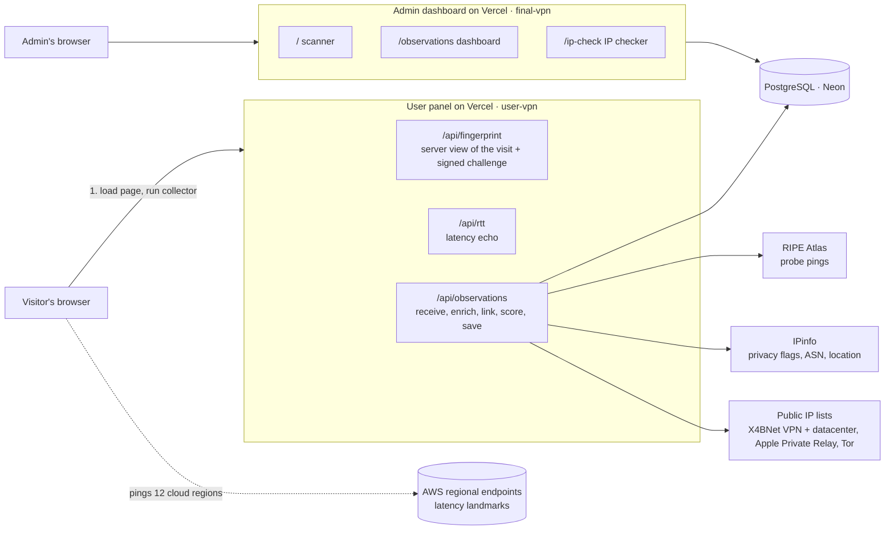

# VPN Detection via Device Fingerprinting and Network Measurements

A research project that answers two questions about every visit to a website:

1. **Which device is this?** Recognise a device from many small browser and hardware measurements, even when it switches browser, uses a private window, or changes IP address.
2. **Is this connection going through a VPN, proxy or relay?** Combine time and latency measurements, public IP lists, IPinfo, RIPE Atlas, WebRTC leak checks and the device's own history into one explainable percentage.

The project has two deployed web apps that share one PostgreSQL database.

| App | Purpose | Live link |
|---|---|---|
| **User panel** (`user-vpn/`) | Public site. When someone opens it, everything is collected automatically and saved. The visitor sees nothing about the result. | https://vpn-ikf7.vercel.app/ |
| **Admin dashboard** (`final-vpn/`) | Lab scanner and dashboard for the researchers. Shows every saved scan, how likely each is to be a VPN, and which scans look like the same device. | https://vpn-chi-six.vercel.app/ |

> This is a research prototype. The percentages it produces are **research estimates, not proof**, and must be calibrated on labelled data before any production use. See [Limitations](#limitations).

---

## Contents

1. [How it works in one page](#how-it-works-in-one-page)
2. [Repository layout](#repository-layout)
3. [Architecture](#architecture)
4. [Stage 1: what a visit collects](#stage-1-what-a-visit-collects)
5. [Stage 2: browser fingerprinting parameters (single browser)](#stage-2-browser-fingerprinting-parameters-single-browser)
6. [Stage 3: recognising one device across browsers](#stage-3-recognising-one-device-across-browsers)
7. [Stage 4: VPN detection](#stage-4-vpn-detection)
8. [Stage 5: combining the evidence](#stage-5-combining-the-evidence)
9. [Stage 6: storage and the admin dashboard](#stage-6-storage-and-the-admin-dashboard)
10. [Results so far](#results-so-far)
11. [Running it locally](#running-it-locally)
12. [Configuration (environment variables)](#configuration-environment-variables)
13. [Deploying to Vercel](#deploying-to-vercel)
14. [Testing and quality checks](#testing-and-quality-checks)
15. [Privacy, ethics and consent](#privacy-ethics-and-consent)
16. [Limitations](#limitations)
17. [Roadmap](#roadmap)
18. [Research basis](#research-basis)

---

## How it works in one page

```
 Visitor opens the site
        │
        ▼
 1. COLLECT      browser + hardware fingerprint, connection timing, pings to 12 cloud regions,
                 WebRTC address, optional location, server-side IP and headers
        │
        ▼
 2. RECOGNISE    compare with every earlier scan: "how likely is this the same physical device?"
                 (works across Chrome / Firefox / Safari, private windows, and IP changes)
        │
        ▼
 3. DETECT VPN   IP lists · IPinfo · RIPE Atlas · timezone vs IP · latency vs claimed location ·
                 WebRTC leak · proxy headers · "has this device left its usual network?"
        │
        ▼
 4. COMBINE      add the evidence as log-likelihood ratios with a 5% prior → one VPN percentage,
                 with every reason listed
        │
        ▼
 5. STORE + SHOW save to PostgreSQL → admin dashboard shows the VPN %, the verdict,
                 and which other scans look like the same device
```

The key idea: **a VPN changes the network a device appears from, not the device itself.** Once the system recognises a device, that device's own history (its usual networks, its usual latency, its usual country) becomes the baseline, and a VPN shows up as a departure from it.

---

## Repository layout

| Folder | What it is |
|---|---|
| [`user-vpn/`](./user-vpn) | **User panel.** Next.js app. A public landing page (styled like a research-lab site) that silently runs the collector on load and posts one scan. Contains its own copy of the detection code in `src/utils`. |
| [`final-vpn/`](./final-vpn) | **Admin dashboard and lab scanner.** Next.js app with the scanner (`/`), the saved-data dashboard (`/observations`) and a standalone IP checker (`/ip-check`). Holds the research write-ups, unit tests and the re-scoring script. |
| [`presentation/`](./presentation) | A static slide deck (29 pages, annotations supported) explaining the whole project. Open `presentation/index.html` or run `npx serve presentation`. |
| [`final/`](./final) | The earlier "Device Linkage Lab" edition (device linkage only, before the VPN model was added). Kept for reference. |
| [`data/`](./data), [`vpn-midsem-presentation/`](./vpn-midsem-presentation) | Early prototype and mid-semester presentation material. |
| PDFs in the root | The papers the method is based on (see [Research basis](#research-basis)). |

Research documents inside `final-vpn/`:

- [`BROWSER_FINGERPRINTING_RESEARCH.md`](./final-vpn/BROWSER_FINGERPRINTING_RESEARCH.md): foundations, methodology, test matrix and privacy controls.
- [`RESEARCH_2022_2026.md`](./final-vpn/RESEARCH_2022_2026.md): recent papers, the linkage model design and results.
- [`VPN_DETECTION_RESEARCH.md`](./final-vpn/VPN_DETECTION_RESEARCH.md): the VPN papers, every signal and weight, results and the deployment checklist.

> The two apps contain **identical detection code** (`src/utils`). A visitor scan is therefore scored exactly like a lab scan. If you change the detection code, change it in both folders.

---

## Architecture



**Data flow of one visit (user panel)**

1. The page loads and the collector starts. Nothing is shown to the visitor.
2. `GET /api/fingerprint` returns the server's view of the visit: the canonical client IP, Vercel geolocation headers, proxy headers, and a signed, short-lived scan challenge.
3. The browser measures round-trip latency to the site (`/api/rtt`) on an idle page, because GPU probes would inflate it.
4. The browser runs the fingerprint collectors, the WebRTC probe, the 12 landmark pings and (if the visitor allows it) asks for location.
5. The browser sends one JSON `POST /api/observations` with the challenge.
6. The server validates the payload and the challenge, enriches the IP (lists, IPinfo), compares the scan with earlier scans, computes the VPN percentage, and saves one row.
7. The visitor receives only `{ ok: true }`. The admin dashboard shows the full result.

**Protection against abuse:** payload limit of 300 KB, rate limit per IP (30 scans per 10 minutes), strict validation of every field, and an HMAC-signed challenge so a scan cannot be replayed.

**Where secrets live:** only in server environment variables. The database URL, IPinfo token, RIPE Atlas key and signing keys never reach the browser.

---

## Stage 1: what a visit collects

A scan is one record made of three kinds of data:

| Source | Data | Examples |
|---|---|---|
| **Browser** (JavaScript) | The fingerprint and measurements | canvas, WebGL, audio, fonts, screen, GPU timing, WebRTC address, latency to the server, pings to 12 cloud regions, optional GPS location |
| **Server** (the HTTP request) | What the network shows | canonical client IP, request headers (`User-Agent`, `Sec-CH-UA*`, forwarding headers), Vercel geolocation (country, region, city, latitude, longitude, timezone), edge region |
| **Enrichment** (outside services and lists) | What is known about that IP | VPN / datacenter / Tor / Apple-relay list membership, IPinfo flags and ASN, RIPE Atlas geolocation check |

Fingerprint schema version: `5.1.0`. Linkage model: `linkage-nb-2026.10`. VPN model: `vpn-device-anchored-1.0`.

---

## Stage 2: browser fingerprinting parameters (single browser)

No single value identifies a browser. Many small values together usually do. Every parameter is judged on three properties:

- **Entropy:** how rare the value is.
- **Stability:** how often it stays the same between two visits of the same device.
- **Collision:** how often two different devices share it (higher on phones, where models are identical).

Each parameter has an expert prior for stability and collision per operating system. Values are compared in four graded bins (**exact, close, partial, different**), so a browser update does not break a match. Raw pixels, audio samples and positions are never sent; the browser sends hashes, buckets and short summaries.

### Parameters used by the linkage model (45)

The **Scope** column says how far a parameter travels:

- **device**: compared across any browsers (it is a property of the machine);
- **engine**: compared only inside one rendering engine (for example Chrome and Edge);
- **browser**: compared only inside one browser family.

| Family | Parameter | What is collected | Scope |
|---|---|---|---|
| Platform | Operating system | OS family parsed from user agent and client hints | device |
| | OS version | Version from client hints (`platformVersion`) | device |
| | CPU architecture / bitness | `arm` / `x86`, 32 / 64-bit | device |
| Model | Device model | Model from client hints or the user agent (phones) | device |
| Hardware | Logical CPU cores | `hardwareConcurrency` (bucketed) | device |
| | Memory bucket | `deviceMemory` (bucketed) | device |
| | Display refresh rate | Measured from animation frames | device |
| | Pointer polling rate | Mouse report rate from coalesced pointer events (needs about 40 movements) | device |
| Display | Physical screen resolution | Width, height (bucketed) | device |
| | Device pixel ratio | Bucketed pixel ratio | device |
| | Taskbar / dock insets | Difference between screen and available area | device |
| | Colour gamut, pointer, touch | Gamut, dynamic range, pointer and hover type, touch points | device |
| GPU | GPU vendor family | Vendor family from WebGL | device |
| | GPU model tokens | Normalised renderer tokens (so `ANGLE (Apple … M2 …)` and `Apple M2` overlap) | device |
| | WebGPU vendor / architecture | Adapter info | device |
| | WebGPU subgroup sizes | Min / max subgroup size | device |
| GPU timing (experimental) | DrawnApart timing profile | Draw-loop timing at 16 points, 7 rounds; compared by correlation | device |
| | WebGPU scheduling profile | Atomic ticket order across workgroups, detrended into 32 buckets | device |
| OS assets | Installed font inventory | 170 fonts tested with canvas text metrics | device |
| | Core font probe | Smaller font set from schema 4 (older scans) | device |
| | Emoji font release | Which Unicode release (11–16) the emoji font supports | device |
| | Emoji glyph metrics | Glyph widths of emoji | device |
| | Writing-system support | Glyph support for 36 scripts | device |
| | Local speech voices | Installed speech-synthesis voices (opt-in) | device |
| | Default generic-font metrics | Metrics of `serif`, `sans-serif`, `monospace` defaults | engine |
| Locale | Timezone | Canonical IANA name (`Asia/Calcutta` and `Asia/Kolkata` are merged) | device |
| | Primary language | `navigator.languages[0]` | device |
| | Locale formatting | Calendar, hour cycle, number formats | device |
| Audio hardware | Audio output | Output sample rate and channel count | device |
| | Media device counts | Number of microphones, cameras, speakers | browser |
| Engine rendering | Canvas hash | Hash of a hidden drawing (also checked for repeatability) | engine |
| | Noise-tolerant canvas grid | 16×4 luminance grid that survives noise-adding browsers | engine |
| | WebGL parameters | Hash of capability parameters | engine |
| | WebGL clear-colour render | Hash of a rendered frame | engine |
| | Audio DSP hash | Hash of an offline audio graph render | engine |
| | Audio DSP summary | Rounded summary of the same render | engine |
| | JS math library | Hash of results of many floating-point functions | engine |
| | NDSS 2017 task hashes | Optional paper-derived rendering tasks (off by default) | engine |
| Browser config | Browser major version | Version number | browser |
| | API capability set | Which web APIs exist | browser |
| | Media codec set | Supported codecs | browser |
| | CSS system colours | Resolved system colour keywords | browser |
| Network | Egress network prefix | Same /24 or /16 as the earlier scan | device |

### Other values stored with every scan

| Value | Purpose |
|---|---|
| Full `User-Agent`, languages, platform, raw CPU cores, raw device memory, touch points, colour depth | Display and consistency checks |
| Storage capability flags (cookies enabled, localStorage, sessionStorage, IndexedDB) | Browser capability profile |
| Network Information API (effective type, downlink, RTT) | Connection context |
| WebRTC ICE candidates (`host`, `srflx`, `relay`, mDNS) | WebRTC leak check (Stage 4) |
| Protection indicators (Brave, Firefox resist-fingerprinting, masked WebGL, randomised canvas) | Decide which parameters to exclude |
| Environment checks (JavaScript user agent vs HTTP header, client-hint platform vs parsed OS) | Spoofing consistency notes |
| Browser and coarse-device signatures (SHA-256) | Quick comparison keys |
| Landmark pings (12 regions: city, coordinates, fastest RTT, samples) | Latency-based location check |
| Client latency (minimum, median, sample count) | Application round-trip time |
| Device location (latitude, longitude, accuracy), only if allowed | Compare with IP location |
| Dual-stack path probes (optional) | IPv4 / IPv6 path evidence |
| Protected components | Server-side HMACs of selected fingerprint components |

### When browsers hide or fake values

- Brave, Firefox private mode and Safari add noise or mask the GPU name. The collector tests for this (solid-colour canvas read-back, rendering twice and comparing, masked WebGL strings, known flags).
- **Rule:** a randomised parameter is **excluded**, not penalised. It simply does not vote. If too little evidence remains, the answer is "not enough data" instead of a guess.

---

## Stage 3: recognising one device across browsers

Chrome and Firefox on the same laptop render differently, but the laptop is the same. The linkage model (`src/utils/linkage.ts`) works as follows.

1. **Scope split.** Each parameter is tagged device / engine / browser (table above). Chrome vs Chrome uses all three layers; Chrome vs Edge uses device and engine; Chrome vs Firefox uses only device features. This follows Cao, Li and Wijmans (NDSS 2017).
2. **Graded agreement.** Each comparison falls into exact / close / partial / different (Jaccard for sets, correlation for timing profiles, tolerances for metrics).
3. **Learned likelihood ratios.** Each bin's probability under "same device" and "different device" is a Dirichlet blend of the expert prior and counts from labelled pairs in the database. The model works from the first scan and becomes data-driven as labelled data grows.
4. **Correlation control.** Ratios are summed per family and capped (13 families, each with its own positive and negative cap), so fonts, emoji and voices, which all follow the OS image, cannot outvote everything else.
5. **Randomised parameters are excluded** (see above).
6. **Open-world prior and calibration.** The starting belief is `1 / (known devices + 1)`, at most 10%. Platt scaling with a prior-shift correction switches on automatically at 25 same-device and 25 different-device labelled pairs.
7. **Insufficient evidence never links.** A pair with too few comparable families scores 0, whatever the arithmetic says.
8. **Same-device sets.** Every pair is scored once. A scan joins a set when the model is at least a chosen percentage sure (default 85%) it is the same device as one of its three closest matches (FP-STALKER style, union-find). An optional "mutual closest match" rule also joins two scans that are each other's best match above 50%.
9. **Training set.** The model learns from device names typed by the researchers. Public-visitor scans have no real device name, so they are **scored against the model but never train it**.

**Worked example (from the project's own data).** Two visits to the user panel on the same Linux laptop, one in Chrome 152 and one in Firefox 159, score **70.7% same device**. The browser and engine differ, so canvas, audio and WebGL hashes do not vote; OS, screen, timezone, language, GPU family and the shared network do.

The model is checked offline with a **leave-both-devices-out** evaluation: each pair is scored with counts that exclude both of its devices, so the model never sees the answer.

---

## Stage 4: VPN detection

The VPN model (`src/utils/vpn-detection.ts`, `ip-intel.ts`) collects independent kinds of evidence. Each signal has a weight, a natural-log likelihood ratio (positive means more likely VPN). Signals are grouped, and each group is capped so correlated signals cannot dominate.

### 4.1 Time and latency

| Signal | Rule | Weight |
|---|---|---|
| **Timezone mismatch** | Browser timezone offset and IP-location timezone offset differ by 60 min or more | +2.0 |
| Timezone consistent | Offsets equal | −0.5 |
| **Large unexplained latency** | Excess latency over the best-fitting landmark above 180 ms | +2.4 |
| Unexplained latency | Excess above 100 ms | +1.3 |
| Latency fits the IP location | Excess below 50 ms | −0.9 |
| **Impossible IP location** | A landmark more than 1,500 km away answers faster than 80% of the speed-of-light minimum for the claimed place | +1.6 |
| **Latency vs browser timezone** (when the IP location is unknown) | Nearest landmark far slower than the timezone's region allows: excess above 200 ms / above 120 ms | +2.0 / +1.0 |
| **Application vs TCP delay** (optional) | Application RTT minus TCP RTT above 50 ms (CalcuLatency); needs a trusted front end to supply TCP RTT | +2.2 |

**Pinging servers (latency landmarks).** The browser times requests to 12 cloud regions at known coordinates: Mumbai, Hyderabad, Singapore, Tokyo, Sydney, UAE, Frankfurt, London, N. Virginia, N. California, São Paulo and Cape Town (AWS DynamoDB `/ping` endpoints, requested with `no-cors`; only the arrival time is used). One warm-up request per region, then the fastest of three samples; about 2 seconds in total.

Light in fibre covers roughly 200 km per millisecond, so a round trip of *t* ms bounds the distance to about *t × 100 km*. A client really at the IP's location has only last-mile delay. Through a distant VPN exit, every path first travels client → exit, which no landmark can explain:

```
excess latency = min over landmarks of ( measured RTT − distance(IP location, landmark) / 100 )
```

### 4.2 Network identity (lists and IPinfo)

| Signal | Source | Weight |
|---|---|---|
| Tor exit | Tor Project bulk exit list | +5.0 |
| Known VPN network | X4BNet `lists_vpn` (VPN netblocks and ASNs) | +4.0 |
| Datacenter / hosting network | X4BNet datacenter list (only if not on the VPN list) | +2.8 |
| iCloud Private Relay | Apple egress ranges (labelled as relay, not VPN) | +1.5 |
| On none of the lists | Local list check | −0.7 |
| Exit shared by devices from elsewhere | At least 2 other inferred devices used this /24 while their own usual network is different | +1.8 |
| IPinfo flag: Tor / VPN / proxy | IPinfo privacy detection | +5 / +4 / +3 |
| IPinfo flag: relay / hosting | IPinfo privacy detection | +1.5 / +2.2 |
| IPinfo: no flags | IPinfo privacy detection | −0.8 |
| Network owner named like a VPN company / a host (no privacy plan) | IPinfo ASN name | +1.6 / +0.9 |
| MaxMind anonymous VPN / public / residential proxy (optional) | MaxMind Insights | +3.6 / +3.0 / +2.6 |

- The lists are downloaded by the server, cached for 24 hours and matched locally with binary search over merged CIDR ranges (IPv4 and IPv6). **No visitor IP is sent to any outside service for the list check.**
- **IPinfo** results are cached for 7 days. The token is sent in an `Authorization` header, never in a URL.
- IP geolocation comes free from Vercel's request headers (country, region, city, coordinates, timezone).

### 4.3 Location truth (RIPE Atlas)

An IP address cannot be nearer to a probe than light allows. RIPE Atlas pings the target from probes around the world; each probe gives a hard distance bound (`distance ≤ RTT × 100 km`, plus 60 km slack for fuzzed probe positions). If the claimed location lies outside a probe's bound, the address is not where geolocation says. This is how VPN "virtual locations" give themselves away.

- Probes: 4 within 150 km of the claimed place, plus far probes in 8 countries (US, BR, GB, ZA, IN, SG, JP, AU); up to 12 probes, 2 pings each.
- Verdicts: **inconsistent +3**, **consistent −1**, inconclusive (no vote).
- It costs credits, so it runs only when cheaper layers are unsure (likelihood between 20% and 85%), at most 20 measurements per day, privately. It is asynchronous: the result applies when the scan is re-scored.

### 4.4 Leaks and headers

| Signal | Rule | Weight |
|---|---|---|
| WebRTC reveals a different address | STUN server-reflexive address differs from the HTTP address (same IP family) | +2.7 |
| WebRTC consistent | Same address | negative |
| Forwarding proxy headers | `Via`, `Forwarded`, `X-Proxy-ID` and similar present | +1.5 |

### 4.5 Device history (the device compared with itself)

| Signal | Rule | Weight |
|---|---|---|
| Device left its usual network | Current /16 is not among the device's earlier clean networks | +1.4 |
| Device on its usual network | Current /16 is one of them | −1.0 |
| Slower than usual | RTT at least baseline + 50 ms and 1.15× baseline | +1.0 |
| Latency as usual | Within ±20 ms of baseline | −0.3 |
| Nearest landmark much farther than usual | Landmark floor at least 60 ms above the device's baseline | +1.2 |
| Device appears from a new country | IP country not among the device's earlier clean scans | +1.2 |

**Clean history only.** A scan counts toward a device's baseline only if it was on no VPN, datacenter or Tor list and was not itself judged likely VPN. Otherwise a device that once used a VPN would learn the VPN exit as "home".

### 4.6 Integrity

Client-header mismatches (JavaScript user agent vs HTTP header) and OS / client-hint conflicts add up to +0.8.

---

## Stage 5: combining the evidence

```
x = log-odds of the prior  +  Σ group totals (each group capped)
VPN probability = 1 / (1 + e^(−x))
```

| Group | Cap (positive / negative) |
|---|---|
| Network | +5.5 / −1.2 |
| Path | +4 / −1.2 |
| Location | +3 / −1 |
| Device history | +3 / −1.5 |
| Integrity | +0.8 / 0 |

- **Prior:** 5% (`VPN_RISK_PRIOR`), the assumed base rate of VPN use.
- **Verdict bands:** 85% or more **high**, 35% to 85% **elevated**, below 35% **low**.
- **Abstention:** the model answers "not enough data" when nothing strong fired and fewer than 40% of the checks were possible. A Tor or Apple-relay list match identifies the network outright.
- **Every reason is stored** with the score, so the admin sees why a scan scored what it did.

**Example, probably a VPN.** Datacenter list +2.8, device left its usual network +1.4, slower than usual +1.0 = +5.2. Add the prior (−2.94): total +2.26, so **90.5%**, high.
**Example, probably not.** Ordinary ISP −0.7, timezone matches −0.5, on its usual network −1.0 = −2.2. Add the prior: total −5.14, so **0.6%**, low.

The weights are log-likelihood ratios taken from the literature and judgement. They are **not yet fitted** to this project's data.

---

## Stage 6: storage and the admin dashboard

### Database (PostgreSQL, hosted on Neon)

Both apps read and write the same tables, created automatically on first use.

| Table | Contents |
|---|---|
| `vpn_ndss2017_research_observations` | The current set of scans (the main table) |
| `vpn_linkage_archived_observations` | Scans moved out of the current set by an admin ("start a fresh comparison set"); kept, shown, but never compared with new scans |
| `vpn_research_observations` | Scans from the original prototype, read-only history |
| `vpn_linkage_auth_throttle` | Attempt counters that protect the archive password |

Each scan row holds the identifying fields, the full fingerprint (JSON), server network data, path probes, device location, client latency, the stored VPN assessment (`vpn_assessment`) and the original `risk_assessment`. Public-visitor scans are tagged `study_id = public-visitors`; lab scans use `vpn-fingerprint-pilot`.

Without any database URL the apps fall back to a local JSON file (`.research-data/observations.json`, git-ignored), which is useful for offline demos.

### User panel (`user-vpn`)

- A single public page. On load it runs the collector with all probes enabled and posts one scan.
- The collector waits for the page to finish loading before measuring latency, and waits up to 4 seconds for mouse movement so the pointer-rate parameter can be measured.
- A random anonymous id kept in the browser's own storage labels the visit as `Visitor <id>`. The visitor never sees a score.
- The browser's normal permission prompt asks for location. Declining is fine.

### Admin dashboard (`final-vpn`)

- **`/` Scanner:** run a scan by hand, with a name, device slot, browser mode and optional VPN label. Shows the result, the evidence and the closest matches immediately.
- **`/observations` Saved data:**
  - Totals (scans, named devices, browsers, public IPs) and a filter for current / archived / prototype data.
  - **VPN detection panel:** VPN scans caught, false alarms, PR-AUC, and which signals fired on VPN and no-VPN scans.
  - **Same-device sets** at an adjustable threshold.
  - **Compare two scans** with the reasoning behind a match.
  - **All scans:** each row shows the VPN percentage and verdict, **"similar to N"** and, when expanded, the list of other scans it resembles with the probability that it is the same device and each one's own VPN percentage.
  - Archive a batch and start a fresh comparison set (password protected, throttled).
- **`/ip-check` IP checker:** looks up any address against the lists, IPinfo and RIPE Atlas.

### Re-scoring

```bash
cd final-vpn
npm run rescore            # dry run: evaluation and old vs new scores
npm run rescore -- --apply # backs up vpn_assessment, then updates it
```

Scans are replayed in capture order, so each one sees only the scans that existed before it, as the live app does. Only the `vpn_assessment` column is written.

---

## Results so far

Replaying the stored scans in capture order (`npm run rescore`) on the current database:

| Set | VPN scans caught (at 50%) | False alarms on no-VPN scans |
|---|---|---|
| **Current set** (Oct 2026 study and later) | **9 of 9** | **0 of 66** |
| Archived scans (Sep 2026, earlier versions) | 0 of 7 | 0 of 5 |
| Original prototype (Aug–Sep 2026) | 7 of 16 | 1 of 15 |

The older sets lack the newer location and latency data, so they score lower, as expected. On the current set the strongest signals were: *device left its usual network*, the datacenter and VPN lists, and *slower than this device usually is*.

**Read with care.** The VPN sample is small (9 scans). Participants shared one campus or mobile network, which makes "left its usual network" unusually clean. Timezone, landmark and WebRTC signals were added after most of the labelled scans were taken. The weights are not fitted to this data, so the numbers are not overfitted, but they do need recalibration on a larger and more varied labelled set.

---

## Running it locally

Requirements: Node.js 22.6 or newer, npm.

```bash
# Admin dashboard (port 3000)
cd final-vpn
cp .env.example .env.local     # set DATABASE_URL, or leave empty to use the local JSON file
npm install
npm run dev

# User panel (port 3001), in a second terminal
cd user-vpn
cp .env.example .env.local     # use the same DATABASE_URL as the admin app
npm install
npm run dev -- -p 3001

# Slide deck (any static server)
npx serve presentation
```

When running locally there is no trusted proxy, so the browser reports its own public address and the server accepts it as a development fallback. In production set `TRUSTED_PROXY_PROVIDER` (see below) so the visitor's IP comes from the host.

If the animation-driven probes (refresh rate, GPU timing) appear to stall, make sure the tab is in the foreground: browsers pause animation in hidden tabs.

---

## Configuration (environment variables)

Copy `.env.example` to `.env.local` (development) or set the variables in your host (production). **Never commit real values.** `.env*` files are git-ignored.

| Variable | Required | Meaning |
|---|---|---|
| `DATABASE_URL` | Yes (production) | PostgreSQL URL. **Must be identical in both apps** so the admin sees visitor scans. |
| `DATABASE_URL_POOLER` | No | Pooler URL; preferred over `DATABASE_URL` when set |
| `TRUSTED_PROXY_PROVIDER` | Yes (production) | `vercel`, `cloudflare` or `generic`. Without it the visitor IP is not trusted. |
| `TRUSTED_CLIENT_IP_HEADER` | If `generic` | Header carrying the client IP |
| `IP_ENRICHMENT_PROVIDER` | No | `vercel` (default, free edge headers), `maxmind` or `ipapi` |
| `SCAN_SIGNING_SECRET` | Recommended | Signs the per-visit challenge. Use a different random value per app. |
| `FINGERPRINT_HMAC_SECRET` | Recommended | **Must be identical in both apps** so protected components compare |
| `PROBE_SIGNING_SECRET` | If path probes are used | Signs IPv4 / IPv6 path probes |
| `VPN_RISK_PRIOR` | No | Base rate of VPN use, default `0.05` |
| `LINKAGE_PRIOR` | No | Optional fixed prior for "same device" |
| `PUBLIC_IP_LISTS` | No | `true` (default) downloads the VPN, datacenter, Tor and relay lists |
| `IPINFO_TOKEN` | No | Enables IPinfo privacy flags and ASN data |
| `RIPE_ATLAS_KEY` | No | Enables RIPE Atlas active geolocation checks |
| `RIPE_ATLAS_PUBLIC_MEASUREMENTS` | No | `false` (default) keeps measurements private (twice the credits) |
| `ATLAS_DAILY_LIMIT` | No | Maximum Atlas measurements per day, default 20 |
| `MAXMIND_ACCOUNT_ID`, `MAXMIND_LICENSE_KEY` | No | MaxMind Insights for anonymiser flags |
| `TCP_RTT_HEADER_NAME`, `TCP_RTT_HEADER_UNIT` | No | Enables the application-vs-TCP delay check behind a trusted front end |
| `SERVER_LATITUDE`, `SERVER_LONGITUDE` | No | Server location for the speed-of-light check |
| `STUN_URL`, `ALLOW_PUBLIC_STUN` | No | STUN server for the WebRTC leak check |
| `IPV4_PROBE_URL`, `IPV6_PROBE_URL`, `RESEARCH_APP_ORIGIN` | No | Dual-stack path probes |
| `ARCHIVE_PASSWORD_HASH` | Admin only | scrypt hash for the archive action (`npm run hash-password`) |
| `MAINTENANCE_TOKEN`, `RAW_OBSERVATION_RETENTION_DAYS` | Admin only | Authenticated retention endpoint and retention period (default 30 days) |

---

## Deploying to Vercel

The repository holds two apps, so create **two Vercel projects from the same repository**:

| Project | Root Directory | Live link |
|---|---|---|
| User panel | `user-vpn` | https://vpn-ikf7.vercel.app/ |
| Admin dashboard | `final-vpn` | https://vpn-chi-six.vercel.app/ |

Build command `npm run build` (framework: Next.js, detected automatically). Set the environment variables above in each project's settings, with `DATABASE_URL` and `FINGERPRINT_HMAC_SECRET` the same in both, `TRUSTED_PROXY_PROVIDER=vercel`, and a different `SCAN_SIGNING_SECRET` per project. Vercel's free IP geolocation headers are used for IP location, so no external geolocation service is needed.

---

## Testing and quality checks

```bash
cd final-vpn
npm test          # 53 unit tests: linkage model, VPN rules, IP intelligence, security
npm run lint
npm run build

cd ../user-vpn
npm run lint
npm run build
```

The tests cover same-device linking across browsers and VPN changes, exclusion of randomised features, leave-out evaluation, the VPN rules (including list matching, landmark geometry and WebRTC comparison), IP-intelligence scoring and the security helpers.

---

## Privacy, ethics and consent

- A fingerprint links a **device**, not a person, and a VPN percentage is **never proof** of VPN use.
- Raw pixels, audio samples and positions are never stored, only hashes, buckets and short summaries; selected components are also stored as server-side HMACs.
- Location is requested only through the browser's own permission prompt and the scan works without it.
- Visitors are identified only by a random id in their browser, not by name, and never see a verdict.
- Raw observations can be deleted on a schedule through an authenticated retention endpoint.
- Secrets are only ever in server environment variables.

**Before collecting from real visitors**, the study needs: informed-consent wording and a privacy notice that match what is collected; ethics or institutional review approval; and legal review (GDPR and ePrivacy Article 5(3), India's DPDP Rules 2025). The user panel currently shows a one-line notice in its footer, which may not be sufficient consent on its own.

---

## Limitations

- JavaScript values can be changed or replayed. They are not attestation.
- Privacy browsers (Brave, Firefox private mode, Safari, Tor) add noise or normalise values, so some evidence is missing and the model may say "not enough data".
- Identical, identically imaged machines are hard to tell apart.
- The likelihood ratios, caps, the 5% prior and the thresholds are research estimates until calibrated on representative labelled data.
- **Hard VPN cases:** VPN exits near the user, Opera's built-in VPN, residential proxies, and corporate VPNs or cloud desktops. Lists and device history are the fallback.
- Packet-level methods (MTU/MSS, JA4T, protocol fingerprints) need network access a website does not have, so they are not implemented.
- The application-vs-TCP delay check needs a trusted front end that supplies TCP RTT; Vercel does not, so it is off by default.
- The admin dashboard has no login yet; access control is on the roadmap.
- Linking trusts the device names typed by researchers. One device saved under two names counts correct links as mistakes.

---

## Roadmap

- Collect more labelled data: one name per physical device, several browsers, a private window, and VPN on and off. Include identical machines.
- Re-scan the same devices a week later to measure drift.
- Fit the VPN weights on that data, then recalibrate.
- Add a TCP RTT header behind a trusted front end for the CalcuLatency check.
- Add authentication to the admin dashboard.
- Add a proper consent flow to the user panel.
- Decide how returning visitors should be recognised (a first-party cookie was prototyped and removed pending that decision).

---

## Research basis

The papers used or referenced (several PDFs are in the repository root):

| Work | Used for |
|---|---|
| Laperdrix et al., *Beauty and the Beast* (IEEE S&P 2016) | Attribute catalogue, entropy and stability framing |
| Cao, Li, Wijmans, *(Cross-)Browser Fingerprinting via OS and Hardware Level Features* (NDSS 2017) | Device / engine / browser scope split |
| Laor et al., *DrawnApart* (NDSS 2022) | GPU execution-unit timing |
| Hohentanner et al., *AtomicIncrement* (WiSec 2025) | WebGPU scheduling profile |
| Lin et al., *Fashion Faux Pas* (S&P 2023); Trampert et al., *Cascading Spy Sheets* (NDSS 2025) | Font and OS-asset inventory |
| Venugopalan et al., *FP-Inconsistent* (2024/25); Vastel et al., *FP-Scanner* (USENIX Security 2018) | Spoofing and consistency checks |
| Şamlıoğlu et al., *ThresholdFP* (IEEE Access 2025); Vastel et al., *FP-STALKER* | Graded agreement and clustering |
| Chan King Sen, *Prevalence of browser fingerprinting in advertising* (RHUL MSc 2025) | Defences and randomisation detection |
| Ramesh et al., *CalcuLatency* (USENIX Security 2024) | Application vs TCP delay |
| Schwartz et al., *SNITCH* (NDSS) | Delay to landmarks for VPN detection |
| Weinberg et al., *How to Catch when Proxies Lie* (IMC 2018) | Physical-feasibility test of IP location |
| Gueye et al. (IEEE/ACM ToN 2006); Wong et al., *Octant* (NSDI 2007) | Constraint-based geolocation, RTT ≥ distance / 100 |
| Khan et al., *Commercial VPN Ecosystem* (IMC 2018) | Virtual locations of VPN servers |
| Ramesh et al., *VPNalyzer* (NDSS 2022); Vanhoef et al., *TunnelCrack* (USENIX Security 2023) | VPN leaks, WebRTC check |
| Xue et al. (USENIX Security 2022); Alazzam et al., *TPA-SSTM* (Sci. Rep. 2026) | Packet-level VPN fingerprinting (documented, not implementable from a web page) |
| X4BNet `lists_vpn`, Apple iCloud Private Relay egress list, Tor Project exit list | Public IP reputation lists |

Full tables with every parameter and the reasoning behind each weight are in [`final-vpn/VPN_DETECTION_RESEARCH.md`](./final-vpn/VPN_DETECTION_RESEARCH.md), [`final-vpn/RESEARCH_2022_2026.md`](./final-vpn/RESEARCH_2022_2026.md) and [`final-vpn/BROWSER_FINGERPRINTING_RESEARCH.md`](./final-vpn/BROWSER_FINGERPRINTING_RESEARCH.md).
